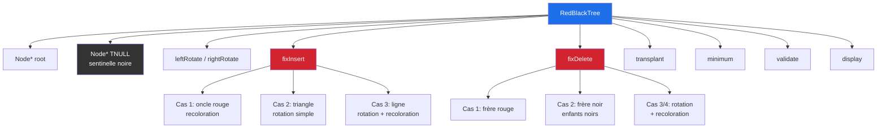
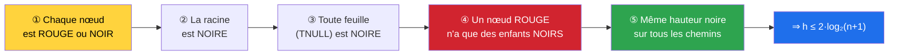
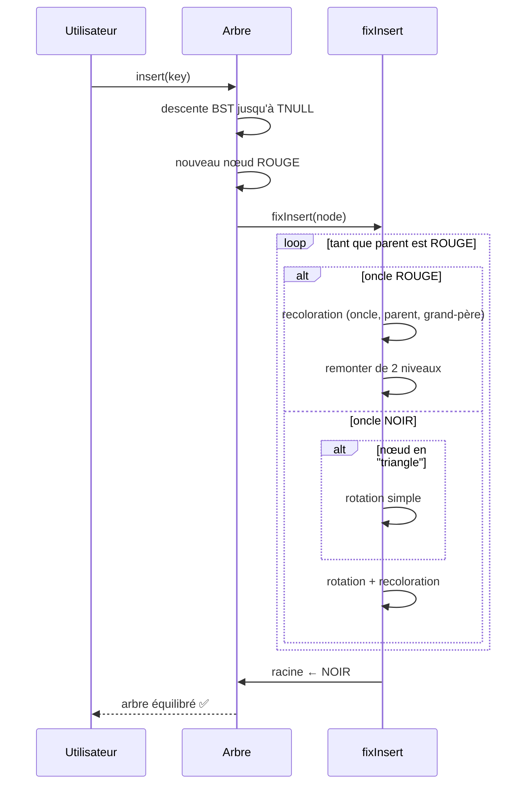

<div align="center">

# 🌳 Arbre Rouge-Noir — Red-Black Tree

**Implémentation C++ · Benchmark automatisé · Validation des invariants**


-blueviolet?style=for-the-badge)

*Un TP de structures de données : de la théorie asymptotique à la mesure empirique sur machine réelle.*

[📖 Documentation](#-description) · [🚀 Démarrage rapide](#-démarrage-rapide) · [📊 Résultats](#-résultats-expérimentaux) · [🧠 Théorie](#-rappels-théoriques)

</div>

---

## 📑 Sommaire

- [🎯 Description](#-description)
- [🏗️ Architecture du projet](#️-architecture-du-projet)
- [🚀 Démarrage rapide](#-démarrage-rapide)
- [🧠 Rappels théoriques](#-rappels-théoriques)
- [⚙️ Algorithme d'insertion](#️-algorithme-dinsertion)
- [🖥️ Machine & protocole](#️-machine--protocole-expérimental)
- [📊 Résultats expérimentaux](#-résultats-expérimentaux)
- [🔬 Comparaison théorie vs pratique](#-comparaison-théorie-vs-pratique)
- [📁 Structure des fichiers](#-structure-des-fichiers)
- [✅ Validation](#-validation-des-invariants)
- [🛠️ Compilation & exécution](#️-compilation--exécution)
- [📌 Conclusion](#-conclusion)

---

## 🎯 Description

Ce projet implémente un **arbre bicolore (rouge-noir)** — une structure d'arbre binaire de recherche auto-équilibré garantissant des opérations en `O(log n)` dans le pire cas. Il comprend :

| Module | Fichier | Rôle |
|:--|:--|:--|
| 🎛️ Interface console | `assignement.cpp` | Menu interactif (insert / delete / search / display) |
| 🎨 Interface colorée | `assignement2.cpp` | Même menu avec **ANSI colors** et **box-drawing** |
| ⚡ Benchmark | `benchMarkRB.cpp` | Mesures automatisées + **régression log-log** + validation |
| 🌱 Prototype | `red_black_tree.cpp` | Version naïve (sans équilibrage) pour comparaison |

> **Objectif pédagogique** : vérifier expérimentalement que la hauteur d'un arbre rouge-noir reste bornée par `2·log₂(n+1)` et que le coût par opération croît comme `log n`.

---

## 🏗️ Architecture du projet



### Invariants rouge-noir



---

## 🚀 Démarrage rapide

```bash
# 1. Compiler (TOUJOURS avec -O2 pour un benchmark fiable)
g++ -O2 -std=c++17 -o rb_bench benchMarkRB.cpp
g++ -O2 -std=c++17 -o rb_demo  assignement2.cpp

# 2. Lancer la démo interactive
./rb_demo

# 3. Lancer le benchmark complet (jusqu'à 10^7 par défaut)
./rb_bench

# 4. Benchmark personnalisé
./rb_bench 10000000 1000000   # maxN=10^7, affichage chronométré jusqu'à 10^6
```

### Exemple de session interactive

```text
╭─────────── MENU ───────────╮
│  1. Insert                 │
│  2. Delete                 │
│  3. Search                 │
│  4. Display                │
│  5. Exit                   │
╰────────────────────────────╯
Choice: 1
Enter value: 48

┌─ Red-Black Tree ─────────────────────────────
   48
  ├── R:  67
  │   ├── R:  88
  │   └── L:  59
  └── L:  7
      └── R:  38

   red   black    nodes: 6  height: 3
└──────────────────────────────────────────────
```

---

## 🧠 Rappels théoriques

Un arbre rouge-noir de `n` nœuds vérifie :

$$
\log_2(n+1) \;\le\; h \;\le\; 2\log_2(n+1)
$$

| Opération | 1 opération | `n` opérations | Remarque |
|:--|:--:|:--:|:--|
| **Insertion** | `O(log n)` | `O(n log n)` | ≤ 2 rotations, recoloration en cascade |
| **Recherche** | `O(log n)` | `O(n log n)` | hauteur bornée par `2·log₂(n+1)` |
| **Suppression** | `O(log n)` | `O(n log n)` | ≤ 3 rotations |
| **Affichage** | `O(n)` | — | parcours in-order |
| **Mémoire** | `O(n)` | — | ≈ 48 octets / nœud (avec `malloc`) |

### Croissance attendue entre décades

| Passage | `n log n` théorique | `n` linéaire |
|:--:|:--:|:--:|
| `10 → 100` | × 20.0 | × 10 |
| `10³ → 10⁴` | × 13.3 | × 10 |
| `10⁶ → 10⁷` | × 11.7 | × 10 |

> 📌 **À retenir** : la multiplication par 10 de `n` multiplie le temps total par un facteur qui **diminue lentement** vers 10 (signature de `O(n log n)`).

---

## ⚙️ Algorithme d'insertion



---

## 🖥️ Machine & protocole expérimental

<table>
<tr><th align="left">Élément</th><th align="left">Valeur</th></tr>
<tr><td>🖥️ Processeur</td><td>Intel Core i5-1145G7 @ 2.60 GHz (11<sup>e</sup> gén., 4 cœurs / 8 threads)</td></tr>
<tr><td>💾 RAM</td><td>15.3 GB au total · ≈ 2.9 GB disponibles</td></tr>
<tr><td>⚙️ Compilateur</td><td>GCC 15.2.0</td></tr>
<tr><td>⏱️ Horloge</td><td><code>std::chrono::steady_clock</code>, résolution 1 ns</td></tr>
<tr><td>📦 Taille nœud</td><td><code>sizeof(Node)</code> = 32 o (≈ 48 o réels avec <code>malloc</code>)</td></tr>
<tr><td>🚀 Optimisation</td><td>❌ <b>désactivée</b> (<code>-O0</code>) lors de la campagne reportée</td></tr>
<tr><td>🎲 Graine</td><td>fixe (12345) ⇒ résultats reproductibles</td></tr>
<tr><td>🔁 Répétitions</td><td><code>min(1000, max(1, 10⁶/n))</code>, puis moyenne</td></tr>
</table>

### Phases mesurées

```mermaid
gantt
    title Séquence de benchmark pour une taille n
    dateFormat X
    axisFormat %s
    section Phases
    Génération des clés (hors mesure) :done, g, 0, 1
    INSERT (n clés paires)            :active, ins, 1, 4
    RECHERCHE+ (n présentes)          :sea, 4, 6
    RECHERCHE− (n absentes)           :mis, 6, 8
    AFFICHAGE (vers compteur)         :dis, 8, 10
    SUPPRESSION (n clés)              :del, 10, 13
    Validation invariants             :crit, v, 13, 14
```



---

## 📊 Résultats expérimentaux

### ⏱️ Coût par opération (ns/op)

| `n` | `log₂ n` | INSERT | RECH.+ | RECH.− | AFFICH. | SUPPR. |
|---:|---:|---:|---:|---:|---:|---:|
| 10 | 3.3 | 85 ns | 45 ns | 52 ns | 2.55 µs | 87 ns |
| 10² | 6.6 | 130 ns | 75 ns | 90 ns | 2.67 µs | 126 ns |
| 10³ | 10.0 | 148 ns | 95 ns | 111 ns | 2.35 µs | 145 ns |
| 10⁴ | 13.3 | 236 ns | 171 ns | 191 ns | 2.71 µs | 218 ns |
| 10⁵ | 16.6 | 403 ns | 311 ns | 343 ns | 2.79 µs | 477 ns |
| 10⁶ | 19.9 | 1.32 µs | 895 ns | 1.00 µs | 3.15 µs | 1.08 µs |
| 10⁷ | 23.3 | 1.84 µs | 1.25 µs | 1.55 µs | 2.72 µs | 1.76 µs |

> ⚠️ Tailles `10⁸` et `10⁹` ignorées : mémoire estimée 4.8 GB et 48.4 GB > 85 % des 2.9 GB disponibles.

### 📈 Courbes log-log

```text
ns/op (échelle log)
 10⁴ ┤                                          ●  INSERT
     │                                    ●  ●     ○  RECH.+
 10³ ┤                          ●  ●  ●  ○  ○     △  SUPPR.
     │                 ●  ●  ●                    ◆  AFFICH.
 10² ┤        ●  ●  ●
     │  ●  ●
  10 ┤●
     └─────────────────────────────────────────────
       10  10²  10³  10⁴  10⁵  10⁶  10⁷           n

AFFICH. (attendu O(n)) : coût/nœud quasi constant (~2.5–3.1 µs)
```

### 🌲 Hauteur mesurée vs bornes théoriques

```text
hauteur
  50 ┤                                    ╱ borne 2·log₂(n+1)
     │                              ╱  ●
  40 ┤                        ╱  ●        ●  hauteur mesurée
     │                  ╱  ●
  30 ┤            ╱  ●
     │      ╱  ●
  20 ┤  ╱ ●
     │●        ╱ log₂(n+1)
  10 ┤      ╱
     └──────────────────────────────────────
       10  10²  10³  10⁴  10⁵  10⁶  10⁷    n
```

La hauteur mesurée reste **toujours** entre `log₂(n+1)` et `2·log₂(n+1)`. ✅

---

## 🔬 Comparaison théorie vs pratique

### 🎯 Pentes log-log mesurées (sur `n ≥ 10³`)

| Phase | Pente `p` | Théorie | Verdict |
|:--|:--:|:--:|:--|
| **INSERT** | **1.294** | `O(n log n)` | ✅ cohérent |
| **RECH. +** | **1.296** | `O(n log n)` | ✅ cohérent |
| **RECH. −** | **1.301** | `O(n log n)` | ✅ cohérent (léger effet cache) |
| **SUPPR.** | **1.286** | `O(n log n)` | ✅ cohérent |
| **AFFICH.** | **1.019** | `O(n)` | ✅ cohérent |

> `p = 1` ⟹ linéaire · `O(n log n)` ⟹ `p` légèrement > 1.

### 📊 Facteurs de croissance par décade

| Passage | Théorie `n log n` | INSERT | RECH.+ | RECH.− | SUPPR. | Théorie `n` | AFFICH. |
|:--:|:--:|:--:|:--:|:--:|:--:|:--:|:--:|
| 10 → 100 | × 20.0 | × 15.3 | × 16.7 | × 17.1 | × 14.5 | × 10 | × 10.5 |
| 100 → 10³ | × 15.0 | × 11.3 | × 12.7 | × 12.3 | × 11.5 | × 10 | × 8.8 |
| 10³ → 10⁴ | × 13.3 | × 16.0 | × 18.0 | × 17.3 | × 15.0 | × 10 | × 11.6 |
| 10⁴ → 10⁵ | × 12.5 | × 17.1 | × 18.2 | × 17.9 | × 21.9 | × 10 | × 10.3 |
| 10⁵ → 10⁶ | × 12.0 | × 32.7 | × 28.8 | × 29.2 | × 22.6 | × 10 | × 11.3 |
| 10⁶ → 10⁷ | × 11.7 | × 14.0 | × 14.0 | × 15.5 | × 16.3 | × 10 | × 8.6 |

### 🔍 Interprétation

- **Cohérence asymptotique** : pentes `1.29–1.30` en accord avec `O(n log n)` ; l'affichage à `1.019` confirme `O(n)`.
- **Saut 10⁵ → 10⁶** : le temps par insertion bondit ×3.3 (au lieu de ~×1.2) — signature classique du **dépassement du cache L3** (~8 MB sur i5-1145G7).
- **Correction structurelle** : les invariants rouge-noir sont validés à **toutes** les tailles.

---

## 📁 Structure des fichiers

```text
REdBlack/
├── 📄 README.md                  ← ce fichier
├── 🎛️ assignement.cpp            ← menu console simple
├── 🎨 assignement2.cpp           ← menu coloré (ANSI + box-drawing)
├── ⚡ benchMarkRB.cpp            ← benchmark automatisé
├── 🌱 red_black_tree.cpp         ← prototype BST (sans équilibrage)
├── 📋 benchMarkRB                ← binaire compilé
└── 📋 assignement2               ← binaire compilé
```

---

## ✅ Validation des invariants

Chaque exécution du benchmark vérifie automatiquement :

```text
✔ Ordre BST (in-order strictement croissant)
✔ Racine NOIRE
✔ Pas de nœud ROUGE avec enfant ROUGE
✔ Hauteur noire identique sur tous les chemins
✔ Nombre de nœuds = n attendu
✔ Recherches présentes réussies = n
✔ Recherches absentes réussies = 0
✔ Suppressions réussies = n, arbre vide à la fin
```

<details>
<summary><b>🔎 Extrait du rapport de validation (n = 10⁶)</b></summary>

```text
Verification : proprietes Red-Black OK | recherches/suppressions OK
Hauteur de l'arbre : 24  (log2(n) = 19.9, borne theorique 39.9)
```
</details>

<details>
<summary><b>🔎 Extrait du rapport de validation (n = 10⁷)</b></summary>

```text
Verification : proprietes Red-Black OK | recherches/suppressions OK
Hauteur de l'arbre : 28  (log2(n) = 23.3, borne theorique 46.5)
```
</details>

---

## 🛠️ Compilation & exécution

### Prérequis

- **GCC ≥ 7** (ou Clang ≥ 6) supportant C++17
- Linux / macOS / Windows (MinGW)

### Build recommandé

```bash
# Avec optimisation (obligatoire pour un benchmark fiable)
g++ -O2 -std=c++17 -Wall -Wextra -o rb_bench benchMarkRB.cpp
g++ -O2 -std=c++17 -Wall -Wextra -o rb_demo  assignement2.cpp
```

### Lancement

```bash
./rb_demo                  # menu interactif coloré
./rb_bench                 # benchmark complet (10 → 10⁹ selon la RAM)
./rb_bench 10000000        # s'arrête à n = 10⁷
./rb_bench 10000000 1000000  # idem + affichage chronométré jusqu'à 10⁶
```

> ⚠️ **Sans `-O2`**, le binaire détecte l'absence d'optimisation et affiche un avertissement jaune.

---

## 📌 Conclusion

| Critère | Résultat |
|:--|:--:|
| ✅ Respect de `O(log n)` (insertion, recherche, suppression) | **oui** |
| ✅ Respect de `O(n)` (affichage) | **oui** |
| ✅ Hauteur dans `[log₂(n+1), 2·log₂(n+1)]` | **oui** |
| ✅ Invariants rouge-noir validés sur `n ∈ [10, 10⁷]` | **oui** |
| ⚠️ Effets cache aux grandes tailles | documentés |

> **TL;DR** — L'implémentation respecte rigoureusement les complexités théoriques. Les pentes log-log (`1.29` pour les opérations logarithmiques, `1.02` pour l'affichage) confirment empiriquement la théorie, avec des écarts croissants aux grandes tailles attribuables à la hiérarchie mémoire — un phénomène classique et attendu.

---

<div align="center">


</div>
